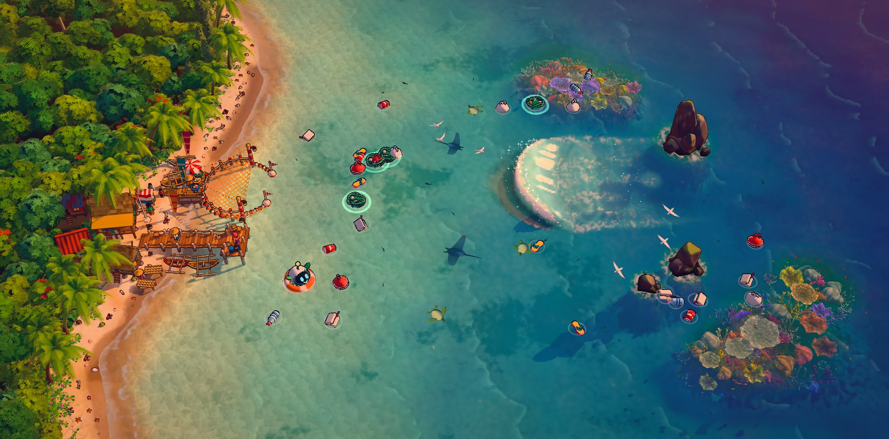
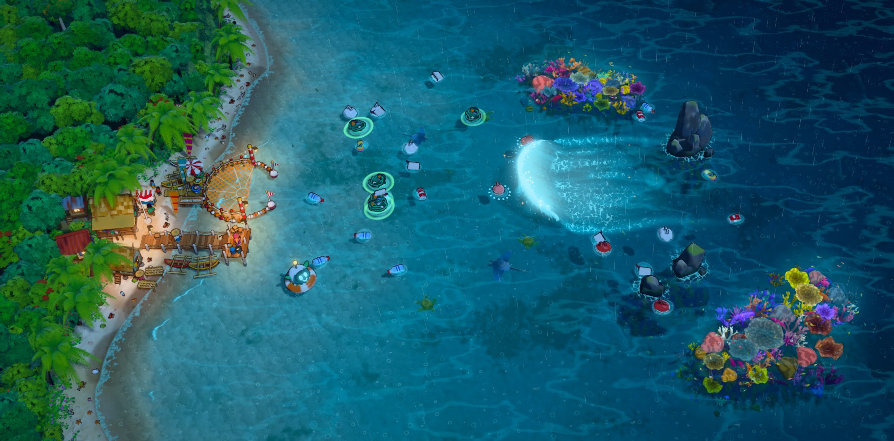

# ALUN: Gema Pesisir Tropis

ALUN adalah permainan dengan satu mekanik di laguna tropis. Saat sampah menutup dermaga dan Pak Damar tertahan di laut, Bu Sari menghidupkan A.L.U.N. untuk membuka jalur pulang. Selama lima hari, pemain membersihkan pesisir, membantu nelayan, dan mempertahankan dermaga dari kapal penjarah. Kapal Induk memasuki laguna pada malam kelima. Dibuat untuk **IT RUSH 2026 Game Jam (Universitas Bengkulu)**, tema *Only One Mechanics in a Tropical*.


| Senja | Badai muson |
|---|---|
|  |  |

## Cara main

Klik atau sentuh air, geser ke sasaran, lalu lepas untuk mengirim ombak. Ketuk tujuan di kiri atas untuk membaca petunjuk bab. Di HP, mainkan dalam posisi horizontal. Ketika suatu pekerjaan gagal, akibatnya terlihat di laguna dan kesempatan berikutnya datang setelah air tenang.

| Input | Fungsi |
|---|---|
| Klik atau sentuh + geser | Kirim ombak |
| Tahan sebelum melepas | Isi tenaga ombak |
| Tab / E | Buka bengkel saat bermain |
| 1 / 2 | Pilih pohon alat atau jurnal di bengkel |
| Esc | Kembali dari bengkel |
| G | Pengaturan (grafis, suara, permainan) |
| M | Bisukan atau nyalakan semua suara |
| Esc / Enter / Spasi | Lewati film |
| Klik / Spasi / Enter | Lanjutkan omongan Bu Sari (Esc melewati adegannya) |

Sapu enam sampah pembuka ke Jaring Desa, lalu dorong peti perkakas ke ujung dermaga. Bu Sari membuka Bengkel dan memasang **Jalur Pasang**. Tahan sampai tiga panah muncul, geser, lalu lepas. Arus bertahan tiga detik dan siap lagi delapan detik setelah dilepas.

Siang berlangsung **90 detik**. Ikatan rongsok membawa dua barang dalam satu sapuan. Muatan senja masuk menjelang malam dan bengkel tutup saat gelap. Bengkel tumbuh bertahap: Hari 1 hanya ada **Tenaga** dan **Muatan**, cetak biru baru datang setiap fajar, dan batas level tiap alat naik satu per hari. Setiap pagi bengkel terbuka sendiri dan hari baru dimulai setelah kamu kembali ke laguna. Di samping tombol Bengkel, chip alat berikutnya menunjukkan harga dan koin yang sudah terkumpul, lalu berkilau saat alat itu terbeli. Pada malam pertama, bantu perahu terakhir Pak Damar merapat untuk mendapat pelindung bambu yang menahan satu serangan. Kapal Pendobrak mengunci arah sebelum melaju. Sapu dari samping agar meleset. Kapal Tunda menarik tongkang berpeti. Sapu melintang pada tongkang untuk mengambil muatannya.

Saat muson, belokkan kedua pelampung pukat dan jauhkan drum dari karang. Setiap alat yang digagalkan merusak Kapal Induk dan membuka kesempatan menghantam lambungnya. Patroli berlanjut setelah fajar.

Kapal penjarah pertama diperkenalkan sekali per simpanan. Kamera mengikuti lima awak dan memperlihatkan dermaga lewat teropong kapten. Awak bersorak saat menyerang dan terhuyung saat terkena ombak.

Progres tersimpan otomatis di browser. Pilih **Lanjutkan** pada layar judul untuk kembali ke bab yang sedang dimainkan. Film cerita bisa dilewati lewat **Pengaturan → Permainan**. Perangkat dengan pengaturan kurangi gerakan juga melewatinya dan langsung menampilkan tujuan permainan.

## Audio

Semua bunyi adalah rekaman: efek suara dan suasana dibuat dengan ElevenLabs Sound Effects, musik dengan ElevenLabs Music. Tidak ada bunyi yang disintesis di kode; Web Audio hanya mencampur rekaman sesuai cuaca, posisi di laguna, kekuatan ombak, dan panjang kombo. Tiap sampah yang masuk jaring berbunyi koin yang naik satu nada per tangkapan beruntun (pentatonik D mayor siang, D minor malam), dan tiap kelipatan lima kombo koin tumpah. Musik punya empat lagu (siang, senja, malam, badai muson) yang berganti dengan crossfade dan berulang di titik loop dalam `public/audio/music/loops.json`.

```bash
npm run generate:sfx -- --dry               # bunyi yang belum punya rekaman, tanpa biaya
npm run generate:sfx -- --takes 3 coin      # tiga versi baru dari satu bunyi
npm run generate:sfx -- --audition coin     # semua versinya ke scripts/.sfx-audition untuk didengar
npm run generate:sfx -- --process           # pasang versi pilihan (`pick`) ke public/audio, tanpa biaya
npm run generate:music -- --sample day      # sampel 30 detik satu lagu
npm run generate:music -- --process         # pasang lagu pilihan dan cari titik loop-nya
```

Rekaman mentah disimpan di `scripts/.sfx-raw/` dan `scripts/.music-raw/` supaya bisa diolah ulang tanpa membayar lagi. Versi yang dipakai tiap bunyi ditulis sebagai `pick` di `scripts/generate-sfx.mjs`.

Bu Sari memandu lewat adegan bicara. Di langkah pertama dan saat cerita bergerak, laguna berhenti sampai pemain mengeklik atau menekan Spasi untuk lanjut (Esc melewati adegan). Bu Sari tidak membacakan dialognya. Setiap barisnya dibuka dengan seruan pendek dengan suaranya sendiri sesuai suasana baris itu ("Aduh, aduh...", "Eh! Eh, eh... alamak!", "Hoi! Hoi!"), lalu tulisannya diketik pelan seperti orang bicara. Pak Damar, A.L.U.N., dan Penjaga Rimba bicara lewat kartu radio dengan gumam: satu suku kata rekaman per huruf hidup, dinadakan sesuai tokohnya, dan A.L.U.N. berbunyi cicit robot. Dialog adegan dan suasananya ada di `src/story/talk.ts`, jadi teksnya bisa diubah tanpa merekam ulang. Di **Pengaturan → Permainan**, suara tokoh bisa diatur ke Asli, Gumam, atau Diam.

```bash
node --env-file=.env.local scripts/design-voice.mjs              # tiga contoh suara Bu Sari untuk dipilih
node --env-file=.env.local scripts/design-voice.mjs --keep <id>  # simpan pilihan ke scripts/voice-cast.json
npm run generate:voice -- --dry                                   # seruan yang belum direkam, tanpa biaya
npm run generate:voice                                            # rekam seruan baru (butuh ELEVENLABS_API_KEY)
```

Daftar seruan per suasana ada di `scripts/generate-voice.mjs`. Klipnya disimpan di `public/audio/voice/` bersama `manifest.json`.

Suara laut naik perlahan saat audio mulai. Film pembuka memakai lagu senja dengan volume rendah. Saat film bajak laut diputar, musik meredup agar bunyi lambung dan terompet terdengar jelas.

## Menjalankan

Butuh Node.js 20 atau lebih baru.

```bash
npm install
npm run dev      # server pengembangan
npm run build    # hasil di dist/
npm run preview  # mencoba hasil build
npm run uji      # uji alur, ekonomi, dan simpanan tanpa browser
```

Game memerlukan browser dengan WebGL2. Buka `/lab.html` di server pengembangan untuk mencoba bab 1–9, film pembuka, penutup, dan bajak laut (tombol **Pirates**), waktu hari, serta kondisi pesisir.

## Pengaturan

Tekan **G** atau tombol roda gigi. Ada tiga tab:

- **Grafis**: Otomatis, Rendah, Sedang, Tinggi, dan Ultra, bisa diganti saat bermain. Rendah dan Sedang menyimpan latar statis di resolusi asli dan hanya menggambar ulang air serta objek bergerak, jadi tetap tajam di GPU terintegrasi.
- **Suara**: bisukan semua, bunyi saat menyorot tombol, dan volume terpisah untuk semua suara, musik, ombak dan efek, laut dan cuaca, suara tokoh, serta tombol dan menu.
- **Permainan**: suara tokoh, kecepatan teks radio, film cerita, guncangan layar, layar penuh, dan hapus simpanan.

Pengaturan disimpan terpisah dari cerita, jadi tetap ada setelah simpanan dihapus.

## Struktur

| Path | Isi |
|---|---|
| `src/simulation.ts`, `src/world.ts` | Simulasi ombak dan peta laguna |
| `src/story/` | Bab, kejadian patroli, pasokan rongsok, pencemaran, dan pembayaran |
| `src/upgrades.ts`, `src/journal.ts` | Cetak biru bengkel, tingkat alat, dan catatan desa |
| `src/save.ts` | Simpanan lokal v4 dan migrasi v2 |
| `src/audio.ts`, `src/music.ts`, `public/audio/` | Pencampuran Web Audio, pemutar musik, dan rekaman MP3 |
| `src/juice.ts` | Koin terbang ke dompet, chip kombo, dan percikan di HUD |
| `src/story/talk.ts`, `src/voice.ts`, `src/ui-radio.ts` | Dialog adegan Bu Sari, seruan dan gumam, kartu radio, dan adegan bicara |
| `scripts/design-voice.mjs`, `scripts/generate-voice.mjs` | Merancang suara Bu Sari dan merekam seruannya |
| `src/settings.ts`, `src/ui-settings.ts` | Pengaturan dan jendelanya |
| `src/ui.ts`, `src/ui-kit/` | Antarmuka dan potret tokoh |
| `src/scene/` | Renderer 3D, air, hutan, terumbu, desa, dan tingkatan grafis |
| `src/scene/opening.ts`, `src/scene/rescue.ts`, `src/scene/ending.ts` | Film pembuka, penyelamatan induk, dan kepulangan saat fajar |
| `src/scene/pirates.ts` | Awak bajak laut di kapal penjarah dan film perkenalannya |
| `src/scene/story.ts`, `src/scene/fleet.ts`, `src/scene/health.ts`, `src/scene/plates.ts` | Visual cerita, armada, perubahan pesisir, dan label kejadian |
| `tests/` | Skenario uji, bot pemain, dan peluncur `npm run uji` |
| `concepts/` | Klip adegan 3D dan contoh UI kit |

Simulasi berjalan di bidang 2D dan terpisah dari renderer.

## Pustaka dan font

- [Three.js](https://threejs.org), lisensi MIT
- [Fredoka](https://fonts.google.com/specimen/Fredoka) dan [Nunito](https://fonts.google.com/specimen/Nunito), SIL Open Font License
- Musik latar (Siang, Senja, Malam & Badai Muson): dibuat dengan [ElevenLabs](https://elevenlabs.io) Music (music_v2_5)
- Suara Bu Sari: dirancang dengan ElevenLabs Voice Design dan direkam dengan ElevenLabs Text to Speech (eleven_v3). Semua efek suara: ElevenLabs Sound Effects (eleven_text_to_sound_v3)

Pekerjaan yang belum selesai ada di tab [Issues](../../issues).
