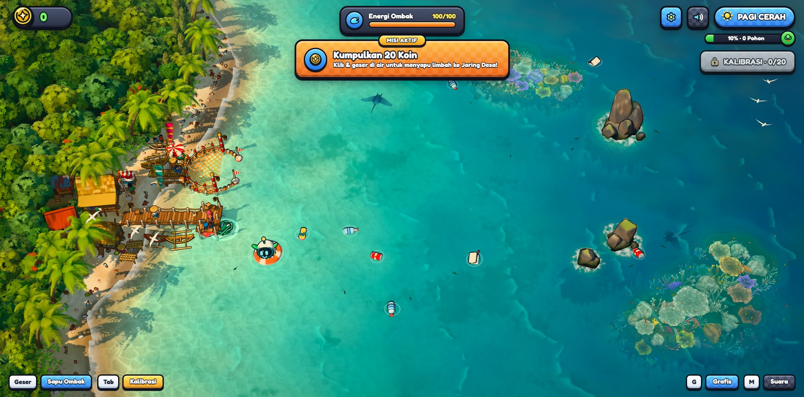

# ALUN: Gema Pesisir Tropis

ALUN adalah permainan dengan satu mekanik di laguna tropis. Saat sampah menutup dermaga dan Pak Damar tertahan di laut, Bu Sari menghidupkan A.L.U.N. untuk membuka jalur pulang. Dalam delapan bab, sapuan ombak yang sama dipakai untuk mengangkat sampah, membebaskan lumba-lumba, menjaga muatan ikan, dan menghadang kapal induk saat muson. Dibuat untuk **IT RUSH 2026 Game Jam (Universitas Bengkulu)**, tema *Only One Mechanics in a Tropical*.



| Senja | Badai muson |
|---|---|
|  |  |

## Cara main

Klik atau sentuh air, geser ke sasaran, lalu lepas untuk mengirim ombak. Ketuk tujuan di kiri atas untuk membaca petunjuk bab. Di HP, mainkan dalam posisi horizontal. Ketika suatu pekerjaan gagal, akibatnya terlihat di laguna dan kesempatan berikutnya datang setelah air tenang.

| Input | Fungsi |
|---|---|
| Klik atau sentuh + geser | Kirim ombak |
| Tahan sebelum melepas | Isi tenaga ombak |
| Tab / E | Buka bengkel saat bermain |
| 1 / 2 | Pilih pohon alat atau jurnal di bengkel |
| Esc | Kembali dari bengkel |
| G | Pengaturan grafis |
| M | Matikan atau nyalakan suara |
| Esc / Enter / Spasi | Lewati film |

Sapu enam sampah pertama ke Jaring Desa, lalu dorong peti perkakas ke ujung dermaga. Bu Sari membuka Bengkel Kalibrasi dan menawarkan Bentang Ombak serta Kapasitas Energi. Pilih simpul di pohon alat untuk melihat efek dan harga. Koin membayar pemasangan, sedangkan cetak biru dan batas tingkat mengikuti kemajuan cerita. Semua bab bisa ditamatkan dengan ombak dasar.

Setelah jaga malam selesai dan pencemaran turun ke 30 atau kurang, jawab panggilan Operasi Badai Muson di bengkel saat siap. Sesudah fajar, Patroli Laguna melanjutkan permainan dengan saldo, peralatan, dan keadaan pesisir yang sama. Jurnal menyimpan riwayat pekerjaan desa.

Kapal penjarah pertama (biasanya di bab 4) diperkenalkan dengan film singkat: kamera berayun ke kapal, memperlihatkan lima awak bajak laut di bawah bendera tengkorak, lalu mengintip lewat teropong sang kapten ke dua keranjang ikan di dermaga. Film ini hanya muncul sekali per simpanan. Sesudahnya awak tetap terlihat di setiap kapal penjarah: bersorak saat merampas keranjang, terhuyung saat lambungnya kena ombak, dan mengepalkan tinju saat mundur.

Progres tersimpan otomatis di browser. Pilih **Lanjutkan** pada layar judul untuk kembali ke bab yang sedang dimainkan. Pengaturan kurangi gerakan pada perangkat melewati film dan langsung menampilkan tujuan permainan.

## Audio

Efek suara dan sampel suasana dimuat sebagai MP3 lokal dari `public/audio/`. Web Audio mencampur sampel sesuai cuaca dan posisi di laguna. Suara prosedural tetap tersedia saat sampel belum siap.

Saat suara pertama kali menyala, laut naik perlahan dari sunyi dan musik permainan masuk pelan-pelan. Film pembuka punya musik tenangnya sendiri yang dibangkitkan Web Audio di nada C (pad hangat, bilah logam bergaya gamelan, dan suling) mengikuti tiap adegan: meredup saat sampah dibuang dan pulih saat A.L.U.N. menyala. Musik permainan baru masuk setelah film selesai. Film bajak laut memakai drum perang, terompet, bunyi teropong, dan dawai rendah, juga dibangkitkan Web Audio.

## Menjalankan

Butuh Node.js 20 atau lebih baru.

```bash
npm install
npm run dev      # server pengembangan
npm run build    # hasil di dist/
npm run preview  # mencoba hasil build
npm run uji      # uji alur, ekonomi, dan simpanan tanpa browser
```

Game memerlukan browser dengan WebGL2. Buka `/lab.html` di server pengembangan untuk mencoba bab 1–9, film pembuka, penutup, dan bajak laut (tombol **Pirates**), waktu hari, serta kondisi pesisir.

## Pengaturan grafis

Otomatis, Rendah, Sedang, Tinggi, dan Ultra, bisa diganti saat bermain. Rendah dan Sedang menyimpan latar statis di resolusi asli dan hanya menggambar ulang air serta objek bergerak, jadi tetap tajam di GPU terintegrasi.

## Struktur

| Path | Isi |
|---|---|
| `src/simulation.ts`, `src/world.ts` | Simulasi ombak dan peta laguna |
| `src/story/` | Bab, kejadian patroli, pasokan rongsok, pencemaran, dan pembayaran |
| `src/upgrades.ts`, `src/journal.ts` | Cetak biru bengkel, tingkat alat, dan catatan desa |
| `src/save.ts` | Simpanan lokal v3 dan migrasi v2 |
| `src/audio.ts`, `public/audio/` | Pencampuran Web Audio dan sampel MP3 |
| `src/ui.ts`, `src/ui-kit/` | Antarmuka |
| `src/scene/` | Renderer 3D, air, hutan, terumbu, desa, dan tingkatan grafis |
| `src/scene/opening.ts`, `src/scene/rescue.ts`, `src/scene/ending.ts` | Film pembuka, penyelamatan induk, dan kepulangan saat fajar |
| `src/scene/pirates.ts` | Awak bajak laut di kapal penjarah dan film perkenalannya |
| `src/scene/story.ts`, `src/scene/fleet.ts`, `src/scene/health.ts`, `src/scene/plates.ts` | Visual cerita, armada, perubahan pesisir, dan label kejadian |
| `tests/` | Skenario uji, bot pemain, dan peluncur `npm run uji` |
| `concepts/` | Klip adegan 3D dan contoh UI kit |

Simulasi berjalan di bidang 2D dan terpisah dari renderer.

## Pustaka dan font

- [Three.js](https://threejs.org), lisensi MIT
- [Fredoka](https://fonts.google.com/specimen/Fredoka) dan [Nunito](https://fonts.google.com/specimen/Nunito), SIL Open Font License
- Musik latar: *Bassa Island Game Loop* & *Island Meet and Greet* oleh Kevin MacLeod ([incompetech.com](https://incompetech.com)), lisensi [CC BY 4.0](https://creativecommons.org/licenses/by/4.0/)

Pekerjaan yang belum selesai ada di tab [Issues](../../issues).
